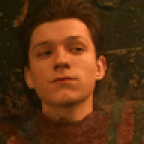
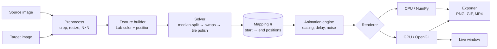

# Pixel Image Transformation

> Rebuild one picture using **only the pixels of another**. Every pixel of a *source* image is moved to a new position so that, together, they form a *target* image. No color is invented, blended or repainted: the output is a pure **permutation** of the source pixels, and the transformation is shown as an animation of the pixels travelling across the canvas.

**Status:** 🚧 under active development. The solver, animation engine, CPU and GPU renderers, live window, command-line tool and MP4/GIF export all work. Progress follows the milestones in [`docs/PLAN.md`](docs/PLAN.md). Features marked *(planned)* do not exist yet.

<p align="center">
  
</p>
<p align="center"><em>The pixels of the first portrait flow in a spiral and settle into the second portrait. No color is added: every pixel of the result comes from the first image. (A higher-quality <a href="examples/gallery/face_a_to_face_b.mp4">MP4</a> is in the gallery folder.)</em></p>

---

## Table of contents

1. [What it does](#what-it-does)
2. [How it works](#how-it-works)
3. [Technology stack](#technology-stack)
4. [Architecture](#architecture)
5. [Repository layout](#repository-layout)
6. [Getting started](#getting-started)
7. [Roadmap](#roadmap)
8. [Documentation](#documentation)
9. [Limitations](#limitations)
10. [Credits and inspiration](#credits-and-inspiration)
11. [Contributing and license](#contributing-and-license)

---

## What it does

Given two images, a **source** (the pixels we are allowed to use) and a **target** (the picture we want to see):

1. Both are resized to the same grid of `N × N` pixels, so both contain exactly `N²` pixels.
2. The program finds, for every target position, which source pixel should land there. This is a **bijection**: every source pixel is used exactly once.
3. The pixels are animated from their original positions to their assigned ones, and the result can be exported as an image, GIF or MP4.

The final picture looks like the target, yet if you sorted its pixels by color you would get exactly the same list as the source. Only the **color grading and the pixels of the first image** are used.

## How it works

The core of the project is an **assignment problem**, a discrete form of *optimal transport*. We look for the permutation `π` that minimizes

```
cost(π) = Σᵢ  ‖ Lab(source[π(i)]) − Lab(target[i]) ‖²  +  λ · ‖ pos(π(i)) − pos(i) ‖²
              └────────── color error ──────────┘        └──── travel distance ────┘
```

- the **color term** makes the result resemble the target (measured in the perceptual CIELAB space, not raw RGB),
- the **spatial term** `λ` keeps pixels close to where they started, so the animation looks like a flow rather than static noise. `λ = 0` gives the best likeness, and larger values give smoother motion.

Solving it exactly (Hungarian algorithm) costs `O(N⁶)` for an `N × N` image, which is too slow beyond small sizes. The project therefore uses a **three-stage pipeline**:

| Stage | Method | Role |
|---|---|---|
| 1. Initial guess | Recursive median-split matching in color+position space | Fast (`O(P log P)`, `P = N²`) and already close to good |
| 2. Refinement | Parallel pairwise swaps (JIT-compiled, multi-core) | Removes most of the remaining error |
| 3. Polish *(optional)* | Exact Hungarian solve on small tiles | Squeezes out the last local errors |

Then an **animation engine** interpolates each pixel along its path (easing, per-pixel delay, optional noise), and a **renderer** draws the frames, either on the CPU with NumPy or on the GPU with OpenGL point sprites.

Details and the mathematics are in [`docs/TECHNOLOGIES.md`](docs/TECHNOLOGIES.md).

## Technology stack

| Area | Choice | Why |
|---|---|---|
| Language | **Python 3.12** | Fast to prototype, huge scientific ecosystem |
| Numerics | **NumPy** | Vectorized array math on whole images |
| Hot loops | **Numba** (`@njit(parallel=True)`) | Compiles the swap solver to multi-core machine code |
| Exact solver | **SciPy** `linear_sum_assignment` | Reference/optimal solution for small grids and tile polishing |
| Image I/O | **Pillow** (+ OpenCV optional) | Loading, cropping, Lanczos resampling |
| Color science | Own CIELAB / OKLab implementation | Perceptual color distance |
| GPU rendering | **moderngl** + GLSL shaders, **glfw** window (optional `[gpu]` extra) | Real-time animation of 10⁴ to 10⁵+ points |
| Video / GIF export | **imageio** + FFmpeg (MP4), Pillow (GIF) | MP4 and GIF output |
| CLI | **Typer** | Clean command-line interface |
| Quality | **pytest**, **ruff**, **mypy**, GitHub Actions | Tests, lint, types, CI |
| Packaging | **uv** + `pyproject.toml` | Reproducible environments |

Every choice is justified in depth in [`docs/TECHNOLOGIES.md`](docs/TECHNOLOGIES.md).

## Architecture



The design rule is **one-way data flow with a single hand-off object**: the solver produces a `Mapping`, and everything after it only reads that mapping. Solvers, renderers and exporters are interchangeable behind small interfaces. The full design is in [`docs/ARCHITECTURE.md`](docs/ARCHITECTURE.md).

## Repository layout

```
.
├── README.md
├── pyproject.toml
├── docs/
│   ├── PLAN.md            project plan, requirements, milestones
│   ├── TECHNOLOGIES.md    deep dive for studying each technology
│   └── ARCHITECTURE.md    modules, interfaces, data flow
├── src/pixelshift/
│   ├── io.py              load / crop / resize / save
│   ├── color.py           sRGB ↔ CIELAB / OKLab
│   ├── features.py        feature vectors (color + position)
│   ├── solvers/
│   │   ├── base.py        Solver interface and registry
│   │   ├── sort1d.py      luminance-sort baseline
│   │   ├── mediansplit.py recursive median-split matching (Numba)
│   │   ├── swaps.py       parallel swap refinement (Numba)
│   │   ├── exact.py       exact Hungarian solver and chunked exact polish (SciPy)
│   │   └── combined.py    the full pipeline solver
│   ├── mapping.py         Mapping dataclass (the hand-off object)
│   ├── metrics.py         cost, color error, travel distance
│   ├── pipeline.py        images in, Mapping out
│   ├── animate.py         easing, departure delays, wobble
│   ├── render/
│   │   ├── cpu.py         crisp "pixel dust" renderer (exact at the first and last frame)
│   │   ├── soft.py        soft particles + motion blur on the CPU (fluid look)
│   │   └── gpu.py         the same soft look on the GPU with OpenGL shaders (real time)
│   ├── live.py            live window and playback controls
│   ├── drop.py            drag-and-drop handling (background solving)
│   ├── sequence.py        seamless loops and photo-chain frame sequences
│   ├── export.py          GIF and MP4 writers
│   └── cli.py             `pixelshift` command (Typer)
├── tests/
├── examples/
│   ├── inputs/            the two example portraits
│   └── gallery/           example outputs shown above
└── .github/workflows/     CI
```

## Getting started

Requires Python 3.11 to 3.13. FFmpeg does not need to be installed: a copy is bundled.

```bash
git clone https://github.com/aminabensouda106-gif/pixel-images-transformation.git
cd pixel-images-transformation

python -m venv .venv
source .venv/bin/activate        # Windows PowerShell: .venv\Scripts\Activate.ps1
pip install -e .

# Turn the first portrait into the second (uses the bundled example images)
pixelshift run -s examples/inputs/face_a.png -t examples/inputs/face_b.png -o result.mp4
```

The first run compiles the numeric kernels, so it takes a few extra seconds. Every later run reuses the compiled code.

### GPU renderer and live window (optional)

Install the extra graphics packages to render on your graphics card and to watch the transformation in a window. They need a GPU and driver with OpenGL 3.3 or newer, which any recent laptop has.

```bash
pip install -e ".[gpu]"

# Watch it in a window
pixelshift live -s examples/inputs/face_a.png -t examples/inputs/face_b.png
```

With the extra installed, `pixelshift run` uses the GPU automatically (`--renderer auto`) and falls back to the CPU if no GPU is usable. A 128 × 128 animation then renders in about **1 second instead of about 1 minute**.

**Live window controls**

| Key | Action |
|---|---|
| `Space` | Pause / play |
| `R` | Restart |
| `B` | Reverse direction |
| `M` | Cycle loop mode: ping-pong, loop, once |
| `←` / `→` | Scrub backward / forward (pauses) |
| `↑` / `↓` | Faster / slower |
| `S` | Save a screenshot (`pixelshift_<time>.png`) |
| `F` | Toggle fullscreen |
| `Esc` or `Q` | Quit |

**Drag and drop.** Drag image files from your file manager onto the window:

- **Two files at once:** the first becomes the source and the second the target.
- **One file:** it becomes the new target, and the current target becomes the new source. Drop photo after photo and each one morphs into the next.

Solving happens in the background, so the window keeps playing and switches to the new animation when it is ready (the title bar shows the progress). If a file cannot be read, the window keeps the current animation and shows the error in the title bar and the terminal. Dropped images use the same grid size (`--size`) as the one you started with.

The window title shows the current time, frame rate and speed. Useful options: `--window 1024` (window size), `--mode loop`, `--fullscreen`, plus the same look options as `run` (`--swirl`, `--lam`, `--duration`, and so on).

**Common options** (`pixelshift run --help` lists them all):

| Option | Default | Meaning |
|---|---|---|
| `-s`, `--source` | required | Image whose pixels are used |
| `-t`, `--target` | required | Image to rebuild |
| `-o`, `--out` | `result.mp4` | `.mp4` or `.gif` for the animation, `.png` for the final image only |
| `--size` | 128 | Grid side `N`; both images become `N × N` pixels |
| `--lam` | 0.001 | Travel penalty. `0` gives the best likeness; larger values make pixels travel less far but add color error (see below) |
| `--solver` | `pipeline` | `sort`, `exact` (up to 64×64), `mediansplit`, `swaps`, `pipeline` |
| `--style` | `soft` | `soft`: fluid glowing particles with motion blur. `pixel`: crisp scattered dust |
| `--renderer` | `auto` | `auto`, `gpu` or `cpu`. `gpu` needs the `[gpu]` extra. The two renderers look the same to the eye, but the output is only bit-for-bit repeatable on the same renderer |
| `--transition` | `spiral` | Motion preset: `spiral`, `wave`, `burst`, `iris` (see [Transitions](#transitions)) |
| `--swirl`, `--burst` | from preset | Spiral rotation in radians; outward burst strength (0 to 3). Override the preset |
| `--wave-shape` | from preset | Direction of the departure sweep: `diagonal`, `horizontal`, `vertical`, `radial`, `radial_in` |
| `--delay`, `--wave`, `--jitter` | from preset | How departures are spread over time: total spread, share that sweeps, share that is random |
| `--blur` | 2.5 | Motion-blur trail length in frames (`soft` style) |
| `--loop` | off | Play A to B and back to A, so a GIF or video loops with no jump |
| `--hold` | 0.8 s | How long to hold on the finished picture |
| `--duration`, `--fps` | 3.5 s, 30 | Animation length and frame rate |
| `--easing` | `smootherstep` | `linear`, `smoothstep`, `smootherstep`, `cubic` |
| `--scale` | 4 | Output pixels per grid pixel |
| `--seed` | 0 | The output is deterministic for a given seed |
| `--png` | none | Also save the final rearranged image |

**Examples**

```bash
# The animation at the top of this page (GIF)
pixelshift run -s examples/inputs/face_a.png -t examples/inputs/face_b.png \
  --size 96 --scale 3 --fps 20 -o examples/gallery/face_a_to_face_b.gif

# Same transformation, reversed direction
pixelshift run -s examples/inputs/face_b.png -t examples/inputs/face_a.png -o reverse.mp4

# Your own photos, larger grid, final image only
pixelshift run -s me.jpg -t friend.jpg --size 256 -o final.png

# A more dramatic spiral, or the older crisp "dust" look
pixelshift run -s a.jpg -t b.jpg --swirl 2.0 --duration 5 -o spiral.mp4
pixelshift run -s a.jpg -t b.jpg --style pixel --swirl 0 --wobble 1.5 -o dust.mp4

# Other motion styles, and a GIF that loops forever (A to B and back to A)
pixelshift run -s a.jpg -t b.jpg --transition iris -o iris.mp4
pixelshift run -s a.jpg -t b.jpg --loop --size 96 --scale 3 --fps 20 -o loop.gif

# Morph through several pictures in one video, closing the loop back to the first
pixelshift chain a.jpg b.jpg c.jpg d.jpg --loop -o chain.mp4
```

### Transitions

`--transition` picks how the pixels move. Every preset can be fine-tuned with `--swirl`, `--burst`, `--wave-shape`, `--delay`, `--wave` and `--jitter`.

| Preset | Look |
|---|---|
| `spiral` (default) | The whole picture swirls like a vortex, with a diagonal wave of departures |
| `wave` | A clean sweep from left to right: one picture is replaced by the other like a wipe made of pixels |
| `burst` | The picture explodes outward into a fine cloud, then pulls back together as the new picture |
| `iris` | The change opens from the center and spreads outward |

### Seamless loops and photo chains

- `--loop` on `run` plays the morph forward, holds on the result, then plays it back, so the file ends exactly where it began. It loops with no visible jump.
- `pixelshift chain` morphs through any number of pictures in order and writes one video. Each morph is built from the previous picture's own pixels. Because that picture then holds the earlier picture's colors, a short cross-fade (`--settle`) restores the real picture before the next morph begins, so there are no jumps. Add `--loop` to morph the last picture back into the first.

**Developing**

```bash
pip install -e ".[dev]"
pytest          # tests
ruff check .    # lint
mypy            # type checking
```

## Roadmap

| Milestone | Goal | Status |
|---|---|---|
| **M0** | Repo, packaging, CI, color conversion | ✅ done |
| **M1** | Baseline solver (luminance sort) and exact solver, with quality metrics | ✅ done |
| **M2** | Median-split + parallel swap solver, benchmarked against the exact one | ✅ done |
| **M3** | Animation engine and CPU renderer, GIF export | ✅ done |
| **M4** | CLI, MP4 export, documentation of results | ✅ done |
| **M5** | GPU renderer and live window | ✅ done |
| **M6** | Stretch features | partly done: drag and drop, four transitions, seamless loops and photo chains are ✅; a web version is planned |

### Measured performance

Solver timings, measured on a 16-core laptop CPU with two portrait photos (rendering the animation takes extra time, about 1 minute for 128 × 128 at the default settings):

| Grid | Pipeline solver | Exact solver | Quality of pipeline |
|---|---|---|---|
| 64 × 64 | about 0.5 s | 12 to 24 s | within 0.2% (λ = 0) and 2.5% (λ = 0.2) of the optimal cost |
| 128 × 128 | about 1.5 s | impractical | not measurable |
| 256 × 256 | about 3.5 to 5 s | impractical | not measurable |

Timings depend on your machine and core count.

**GPU renderer.** Measured on an integrated AMD Radeon GPU (a laptop without a dedicated graphics card), with full quality (7 motion-blur samples per frame):

| Grid | Points | Output | Frame rate |
|---|---|---|---|
| 128 × 128 | 16,384 | 768 px | about 110 fps (the live window holds 60 fps, the display limit) |
| 256 × 256 | 65,536 | 768 px | about 49 fps |
| 512 × 512 | 262,144 | 512 px | about 43 fps |

Larger outputs and a dedicated graphics card change these numbers.

Each milestone has acceptance criteria in [`docs/PLAN.md`](docs/PLAN.md).

## Documentation

- [`docs/PLAN.md`](docs/PLAN.md): requirements, scope, milestones, risks
- [`docs/TECHNOLOGIES.md`](docs/TECHNOLOGIES.md): the theory and tools to study
- [`docs/ARCHITECTURE.md`](docs/ARCHITECTURE.md): modules and data flow

## Limitations

- Source and target must have the same number of pixels, so both are cropped and resized to a common square grid. Fine detail in the target is limited by the **colors available in the source**: a source with no red cannot reproduce a red target.
- **Likeness versus travel.** Matching colors perfectly lets pixels travel anywhere; asking them to stay close to home costs color accuracy. On the example portraits at 128 × 128 the color error (ΔE) is 2.3 at `--lam 0`, 2.9 at the default `0.001` (pixels travel 32% of the grid), 4.7 at `0.01`, and 6.8 at `0.06`. The default sits at the knee of that curve. When the two images' colors differ a lot, the printed ΔE is higher and the result is a stylized version of the target made from the source's palette.
- Results are approximate: the fast solver does not guarantee the globally optimal permutation.
- GIF files are limited to 256 colors per frame, so they shimmer slightly in flight. Use MP4 for the best quality.
- Speed and memory depend on grid size. The exact solver is only practical on small grids.

## Credits and inspiration

The visual effect is inspired by pixel-rearrangement morph demos such as *Obamify*. The theory comes from optimal transport (Monge–Kantorovich) and the classical assignment problem. This project is an independent implementation.

## Contributing and license

Issues and pull requests are welcome. License: to be chosen before the first release (MIT is the usual default for a project like this).
