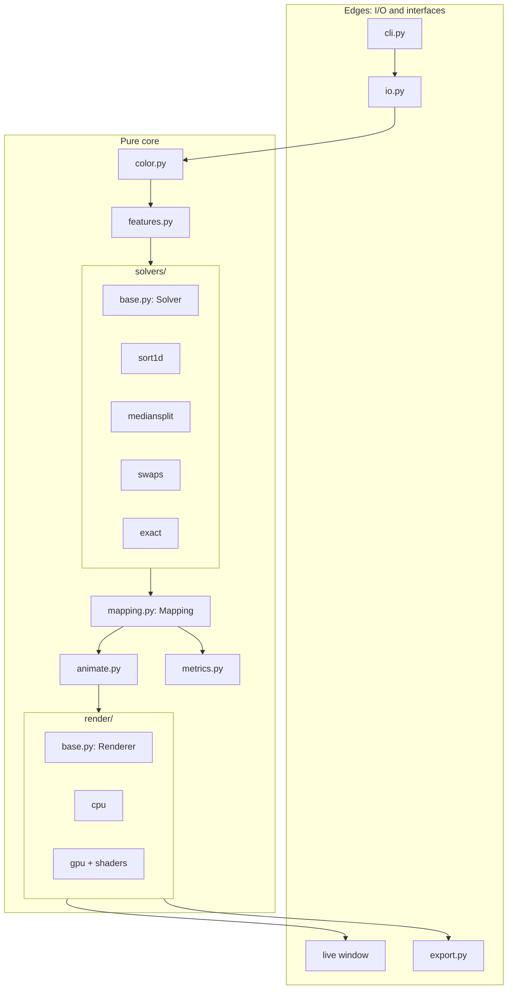
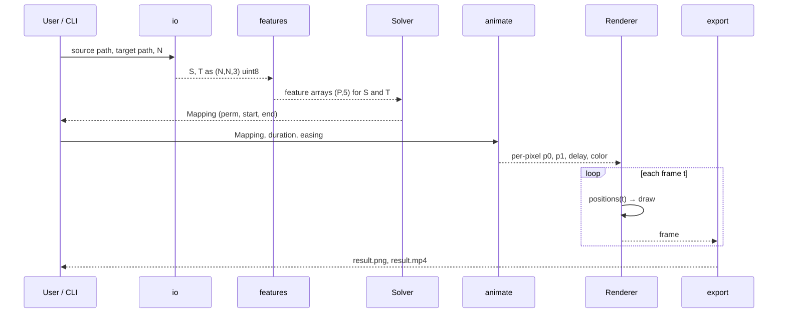

# Architecture

## 1. Principles

1. **One-way data flow.** `images → features → solver → Mapping → animation → renderer → output`. Nothing downstream reaches back upstream.
2. **A single hand-off object.** The solver's only product is a `Mapping`. Animation, rendering and export read it and never need to know which solver made it.
3. **Strategy interfaces** at the two points where we expect alternatives: `Solver` and `Renderer`.
4. **Pure core, thin shell.** Numerical code is functions on arrays, with no I/O or global state. File access, windows and the CLI live at the edges.
5. **Always a fallback.** The CPU renderer and the exact solver are slow but always work; they also serve as test oracles for the fast versions.

## 2. Component view



## 3. Data flow in detail



## 4. Core data types

```python
@dataclass(frozen=True)
class Mapping:
    n: int  # grid side, P = n*n
    perm: np.ndarray  # (P,) int32; perm[i] = source index placed at target slot i
    source_rgb: np.ndarray  # (P, 3) uint8, source pixels in raster order
    cost: float  # final objective value
    meta: dict  # solver name, lambda, seed, runtime, color space

    def start_positions(self) -> np.ndarray: ...  # (P, 2) where each source pixel starts
    def end_positions(self) -> np.ndarray: ...  # (P, 2) where it is assigned
    def result_image(self) -> np.ndarray: ...  # (n, n, 3) the rearranged image
```

**Invariants** (checked in tests and on construction):
- `perm` is a permutation of `0..P-1`.
- `result_image()` has the same multiset of pixels as the source.

```python
class Solver(Protocol):
    def solve(self, src_feat: np.ndarray, tgt_feat: np.ndarray, *, seed: int) -> np.ndarray:
        """Return perm: a permutation of range(P)."""


class Renderer(Protocol):
    def frame(self, t: float) -> np.ndarray:
        """Return an (H, W, 3) uint8 frame for normalized time t in [0, 1]."""
```

## 5. Module responsibilities

| Module | Responsibility | Depends on |
|---|---|---|
| `io.py` | Load, center-crop, resize, save | Pillow |
| `color.py` | sRGB ↔ Lab / OKLab, vectorized | NumPy |
| `features.py` | Build `(P, 5)` vectors: color + weighted position | `color` |
| `solvers/base.py` | `Solver` protocol and a registry (`get_solver("swaps")`) | none |
| `solvers/sort1d.py` | Luminance-rank baseline | NumPy |
| `solvers/mediansplit.py` | Recursive matching in feature space | NumPy |
| `solvers/swaps.py` | Numba-parallel disjoint-pair swap refinement | Numba |
| `solvers/exact.py` | SciPy Hungarian; tile polishing | SciPy |
| `mapping.py` | The `Mapping` hand-off object and its invariants | NumPy |
| `animate.py` | Easing, delays, noise, positions at time `t` | NumPy |
| `render/cpu.py` | NumPy scatter with splatting | NumPy |
| `render/gpu.py` | moderngl point sprites, GLSL in `render/shaders/` | moderngl |
| `export.py` | PNG, GIF, MP4 | imageio |
| `metrics.py` | ΔE, displacement, cost gap, validity | NumPy |
| `cli.py` | Typer commands, wiring only | everything |

Dependencies flow **downward only**; `solvers/` never imports `render/`, and `render/` never imports `solvers/`.

## 6. Solver pipeline (composition)

Solvers compose, so the production pipeline is a chain over one `perm` array:

```
perm0 = MedianSplit().solve(src, tgt)        # initial guess
perm1 = Swaps(rounds=300, radius=schedule).refine(src, tgt, perm0)
perm2 = ExactTiles(tile=32).refine(src, tgt, perm1)   # optional
```

`refine` solvers take an existing permutation and can only **lower or keep** the cost, which is an invariant we test.

## 7. Configuration

A single frozen dataclass `Config`, populated from CLI flags (and optionally a TOML file):

| Field | Default | Meaning |
|---|---|---|
| `size` | 128 | grid side `N` |
| `lam` | 0.2 | spatial weight `λ` |
| `color_space` | `oklab` | `lab` or `oklab` |
| `solver` | `pipeline` | `sort`, `exact`, `mediansplit`, `swaps`, `pipeline` |
| `seed` | 0 | RNG seed for determinism |
| `duration` | 3.0 s | animation length |
| `easing` | `smoothstep` | easing function |
| `fps` | 60 | export frame rate |
| `renderer` | `auto` | `cpu`, `gpu`, or `auto` (GPU if available) |

## 8. Testing strategy

| Layer | Test |
|---|---|
| `color` | round-trip error below 1/255; known reference values |
| `Mapping` | permutation invariant; pixel multiset preserved |
| Solvers | valid permutation; cost ≤ baseline; `refine` never increases cost; fixed seed gives identical output |
| Quality | on 32×32 and 64×64, cost gap vs exact stays under a stated threshold |
| `animate` | `t=0` equals the source layout; `t=1` equals the result layout |
| Renderers | CPU and GPU frames agree within tolerance at `t=0` and `t=1` |
| CLI | end-to-end smoke test on tiny images |

Performance budgets from [`PLAN.md`](PLAN.md) §2 (N1, N2) run as benchmarks, not as unit tests, so they do not make CI flaky.

## 9. Scalability notes

| Grid | Pixels `P` | Dense cost matrix (float32) | Strategy |
|---|---|---|---|
| 64×64 | 4 096 | 64 MB | exact is feasible (ground truth) |
| 128×128 | 16 384 | 1 GB | never build the matrix; use the pipeline |
| 256×256 | 65 536 | 17 GB | pipeline only |
| 512×512 | 262 144 | 275 GB | pipeline, GPU rendering, coarser polish |

## 10. Decisions to record as ADRs

As real decisions are made, each gets a short file under `docs/adr/`: the choice of color space (Lab vs OKLab), the median-split initializer instead of Sinkhorn, Numba instead of a native extension, and the GPU library choice.
